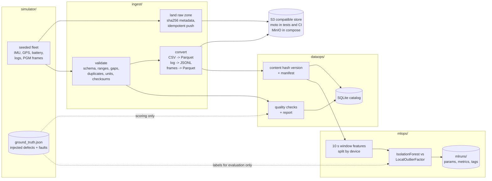

# field-data-pipeline-lab

[](https://github.com/hamza2829/field-data-pipeline-lab/actions/workflows/ci.yml)

DataOps and MLOps pipeline for a **simulated drone fleet**: field devices
produce sensor streams, logs and camera frames with deliberate defects; Python
tools ingest, validate and convert them, push them to S3 compatible object
storage, version every dataset by content hash, check data quality, and run an
automated comparison of two anomaly detection models with local experiment
tracking. Everything runs with zero accounts, keys or manual steps.

## Architecture



Network view (IP plan, ports, DNS, device to server flow): [docs/networking.md](docs/networking.md).

## Repository layout

| Path | What it does |
|---|---|
| `simulator/fleet.py` | seeded fleet of drones; 1 Hz sensors, flight log, 32x32 PGM frames with SHA-256 manifest; injects gaps, duplicates, wrong units (mV, °F), truncated and bit-flipped frames, garbled log lines, and motor fault episodes |
| `ingest/validate.py` | schema, range, gap, duplicate, unit and checksum checks, PGM parser, log parser |
| `ingest/convert.py` | CSV to Parquet (zstd, deduplicated, units normalised, flags kept), logs to JSONL, frame metadata to Parquet |
| `ingest/storage.py` | boto3 object store wrapper: SHA-256 in object metadata, skip unchanged files, verify remote against local |
| `dataops/versioning.py` | content hash dataset versions, manifests, diff, tamper check |
| `dataops/catalog.py` | SQLite metadata catalog (versions, files, quality results) |
| `dataops/quality.py` | quality checks with thresholds, injected vs detected comparison, Markdown + JSON report |
| `mlops/` | window features, device grouped split, MLflow style tracking as local files, automated two model evaluation |
| `pipeline.py` | CLI: `generate`, `ingest`, `validate`, `convert`, `version`, `evaluate`, `all` |
| `docker/` | one Dockerfile per tool, `docker-compose.yml` for the edge simulation (drones, ground station, MinIO, MLOps) |
| `docs/` | [networking](docs/networking.md), [run book](docs/runbook.md), [data dictionary](docs/data_dictionary.md) |
| `tests/` | 67 pytest tests |

## Quick start

```bash
python -m pip install -r requirements-dev.txt
python pipeline.py all --work build
pytest -q
```

Reports land in `build/report/`. No Docker is needed locally; the images are
built and smoke run in GitHub Actions.

## Results

Default run: 6 drones, 900 s each, seed 42. These numbers come from CI run
[#1](https://github.com/hamza2829/field-data-pipeline-lab/actions/runs/45381690354)
and were reproduced exactly from a fresh clone (Python 3.13 locally, 3.12 in
CI) and by the three Docker images chained on a shared volume in CI.

| Metric | Value |
|---|---|
| pytest | 67 passed (local, fresh clone, CI) |
| Raw objects landed in the S3 raw zone | 199 files, 1,030,302 bytes; second push uploaded 0, checksum mismatches 0 |
| Raw sensor rows -> curated rows | 5,373 -> 5,349 (24 replayed duplicates removed) |
| Rows with unit correction (mV -> V, °F -> °C) | 80 |
| Injected defects detected | **28 of 28**, 0 false positives (3 gaps, 6 duplicate blocks, 3 unit blocks, 4 corrupt frames, 12 garbled log lines) |
| Sensor completeness after gaps | 99.056 % |
| Frames intact | 176 of 180 (97.778 %) |
| Log lines parsed | 1,080 (98.901 %) |
| Sensor CSV -> Parquet (zstd) | 745,635 -> 519,302 bytes (1.44x; random float noise compresses poorly) |
| Curated dataset version | 18 files (12 Parquet, 6 JSONL), 715,208 bytes |
| Anomaly windows (10 s) | 535 total; 357 train (4 drones), 178 validation (2 unseen drones, 22 fault windows) |
| Pipeline wall time, all stages | about 4.7 s locally (2 vCPU sandbox; 2.2 s of it is moto start up) |

Model comparison on the validation drones:

| Model | Precision | Recall | F1 | ROC AUC | Avg precision |
|---|---:|---:|---:|---:|---:|
| IsolationForest (200 trees) | 0.750 | 0.682 | **0.714** | **0.969** | 0.638 |
| LocalOutlierFactor (k=25, novelty) | 0.231 | 0.136 | 0.171 | 0.510 | 0.159 |

IsolationForest is selected. LocalOutlierFactor is close to random here: the
battery voltage feature drifts steadily over each flight, and on unseen drones
the nearest neighbour distances are dominated by that drift rather than by
the vibration and heat of a motor fault. Both models use a fixed
contamination of 0.1 while the true fault share in validation is about 12 %,
which caps recall.

CI gates: no failed quality check, every injected defect detected with zero
false positives, idempotent and checksum clean push, best model ROC AUC above
0.9.

## Reproducibility

* The simulator is seeded; the same seed gives byte identical raw files
  (tested).
* Dataset versions are a hash of the curated bytes. A rerun on the same data
  registers no new version (tested). Parquet files embed the writer version,
  so a different pyarrow release gives a different version id for the same
  rows (local `3fefa2a5267bf8db` with pyarrow 26, CI `ef6b5d17758bf1c3`);
  the row level numbers above are identical.
* Model runs record the dataset version they used in `params.json`, and the
  run id is derived from the parameters.

## Honest section

* **All data is synthetic.** No real drone, flight controller, radio link or
  camera was involved. Fault episodes are injected as extra vibration, heat
  and voltage sag, which makes them much easier to separate than real motor
  faults; the model scores say nothing about performance on real flight data.
* **No real cloud.** Object storage is moto (an in-process S3 mock) in tests,
  in CI and by default in the CLI. The compose file wires a MinIO container as
  the S3 endpoint; CI validates that file with `docker compose config` but
  does not start MinIO.
* **Docker** images are built and run in GitHub Actions only, not on my
  machine. The compose based edge simulation as a whole has not been run.
* The "link" between drones and ground station is a shared Docker volume or
  a local directory, not a network transfer.
* Experiment tracking writes MLflow like files; it is not the MLflow server
  or client library.
* Unit detection is a threshold heuristic (battery > 100 means mV,
  temperature > 85 means °F). It works for the injected defects and would
  miss a unit error that stays inside the plausible range.

## License

MIT
