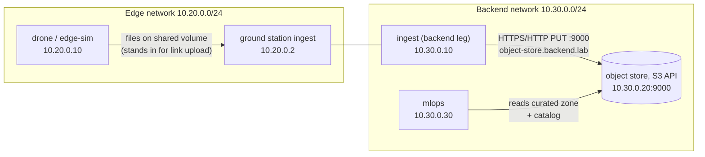

# Networking notes

How data moves from a drone in the field to the server side. The addressing
plan is the one used in `docker/docker-compose.yml`, so it can be inspected
with `docker compose -f docker/docker-compose.yml config`.

## Data flow

The ingest container is dual homed: it is the only service on both networks,
so drones never talk to the object store directly.

## IP addressing

| Network | Subnet | Gateway | Host | Address |
|---|---|---|---|---|
| edge | 10.20.0.0/24 | 10.20.0.1 | ground station ingest | 10.20.0.2 |
| edge | 10.20.0.0/24 | 10.20.0.1 | edge simulator (drones) | 10.20.0.10 |
| backend | 10.30.0.0/24 | 10.30.0.1 | ingest | 10.30.0.10 |
| backend | 10.30.0.0/24 | 10.30.0.1 | object store (MinIO) | 10.30.0.20 |
| backend | 10.30.0.0/24 | 10.30.0.1 | mlops | 10.30.0.30 |

Real fleets would usually get addresses by DHCP on the edge side, with
reservations per drone (by MAC) so logs can be matched to an address.
10.20.0.10 to 10.20.0.250 is left for that pool.

## Ports

| Service | Port | Protocol | Exposed to |
|---|---|---|---|
| object store S3 API | 9000 | HTTP (TLS in production) | backend network, host loopback only |
| object store console | 9001 | HTTP | host loopback only |
| ingest, mlops | none | outbound only | - |

Both published ports bind to `127.0.0.1`, so nothing is reachable from
outside the machine.

## DNS

Docker's embedded DNS resolves service names and the aliases set in the
compose file:

| Name | Resolves to |
|---|---|
| `edge-sim.edge.lab` | 10.20.0.10 |
| `ingest.edge.lab` | 10.20.0.2 |
| `ingest.backend.lab` | 10.30.0.10 |
| `object-store.backend.lab` | 10.30.0.20 |
| `mlops.backend.lab` | 10.30.0.30 |

Clients use the name, never the IP (`S3_ENDPOINT_URL=http://object-store.backend.lab:9000`),
so the object store can move without reconfiguring the tools.

## Device to server data flow, step by step

1. A drone writes `sensors.csv`, `flight.log` and camera frames with a
   `frames.json` manifest (SHA-256 per frame).
2. The ground station picks the files up (here: a shared Docker volume in
   place of a radio or LTE link) and lands them unchanged in the raw zone
   (`s3://field-data/raw/...`). Every object carries its SHA-256 as
   metadata; a repeated upload of the same bytes is skipped, which makes
   retries after a dropped link safe.
3. Validation runs against the landed files: schema, ranges, gaps,
   duplicates, unit heuristics, checksums, log parsing.
4. Conversion writes the curated zone (`s3://field-data/curated/...`):
   Parquet per device, JSON lines for logs, a Parquet frame table.
5. The curated zone gets a content hash version and is registered in the
   SQLite catalog together with the quality results.
6. MLOps reads one exact dataset version, builds features and evaluates the
   models; every run records the dataset version it used.

## What is simulated

There is no radio link, no real drone and no cloud account. The shared
volume stands in for the link, MinIO or moto stand in for S3.
